# Misión Reponedor

Juego web educativo: simulador de reponedor de supermercado para jóvenes de 20 a 24 años, pensado para personas que no leen (todo tiene imagen y voz).

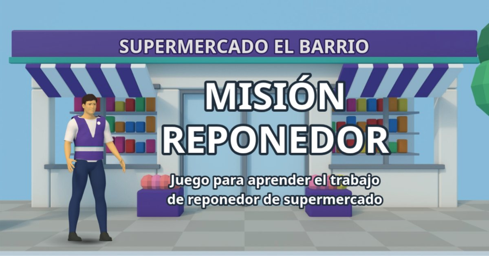

**Jugar:** https://tecmedhub.org/mision_reponedor/ (en celular, mejor instalarlo en la pantalla de inicio: funciona sin internet).

Hecho con **Phaser 3 + Vite**. Gráficos de [Kenney](https://kenney.nl) (CC0). Voces neuronales de Microsoft (edge-tts).

## Capturas

| | |
|---|---|
| 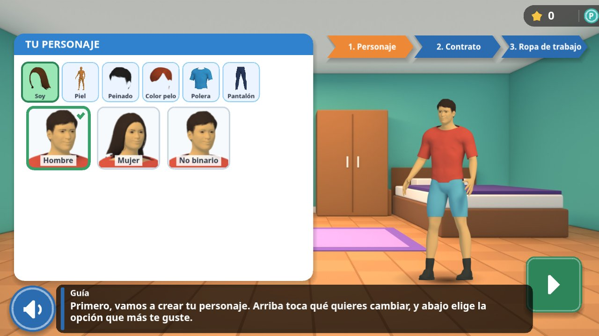 <br> 1. Crear personaje | 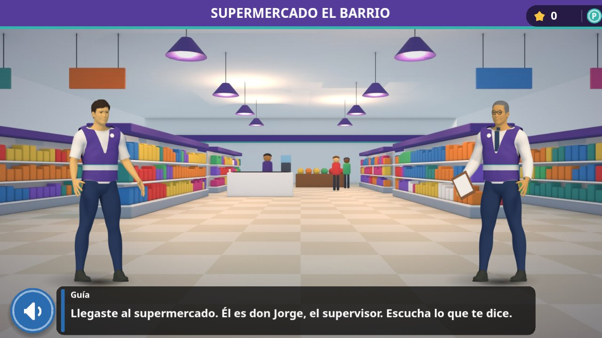 <br> 4. Presentación con el supervisor |
| 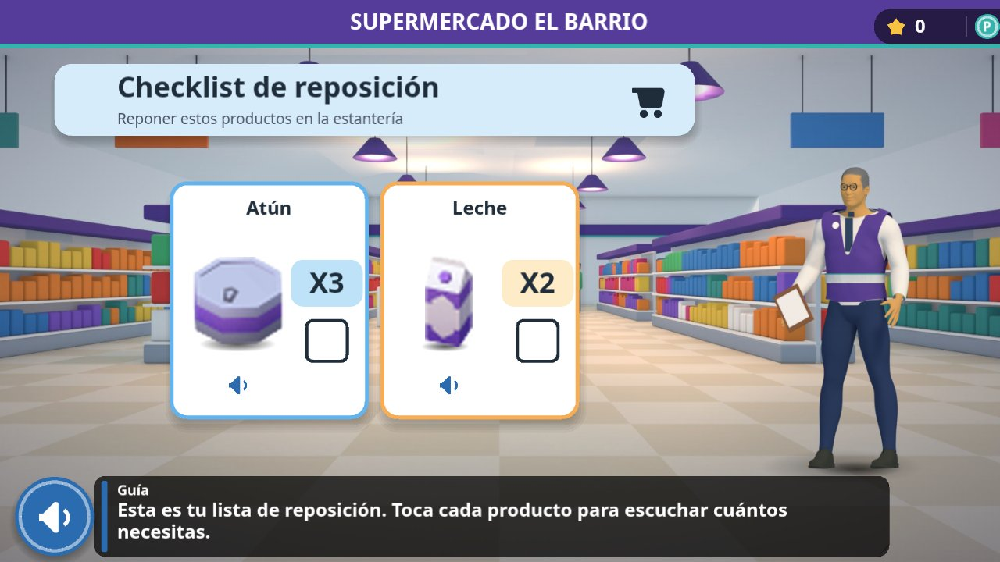 <br> 5. Lista de reposición, leída en voz alta | 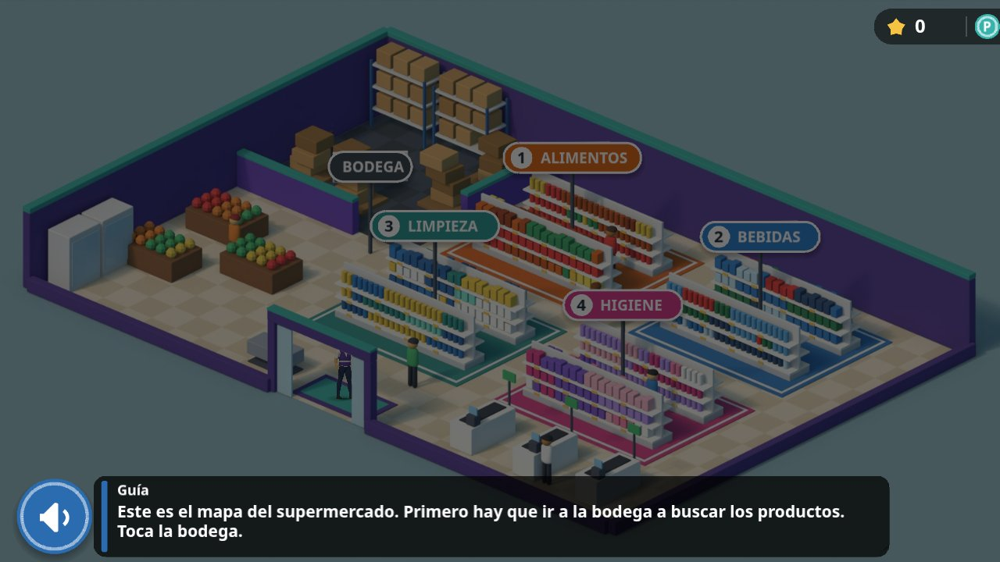 <br> 5. Mapa del supermercado |
| 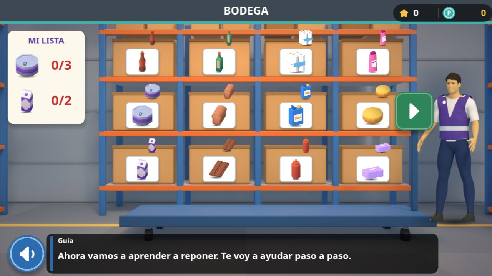 <br> 6. Bodega: buscar y contar | 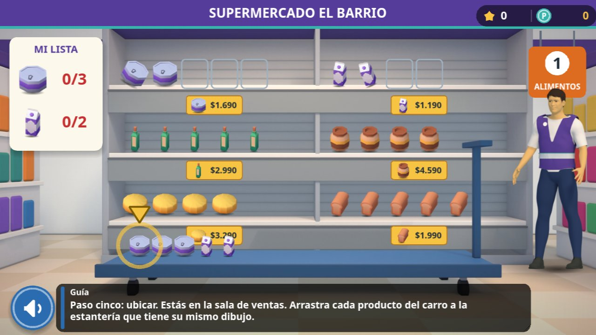 <br> 6. Estantería: ubicar y ordenar |
| 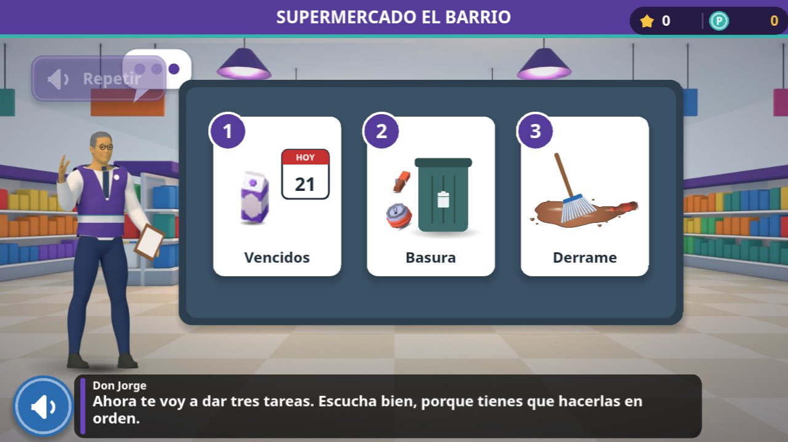 <br> 8. Órdenes del supervisor | 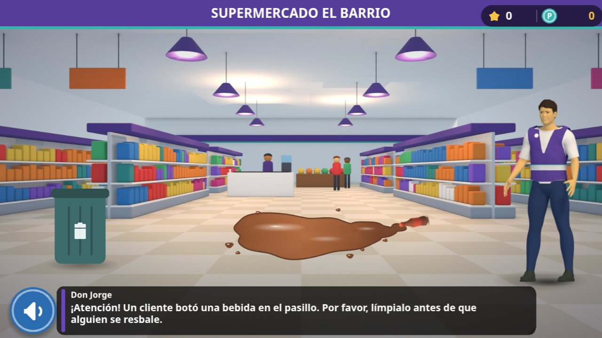 <br> 8. Tarea: limpiar un derrame |
| 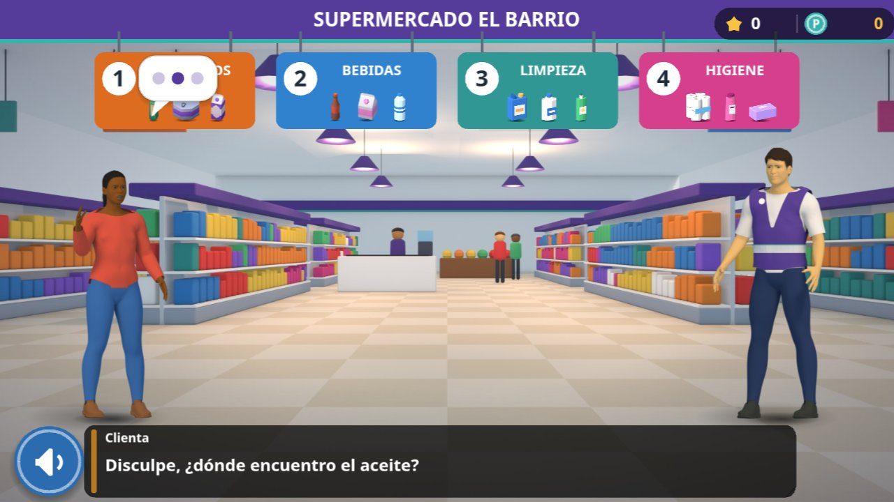 <br> 8. Orientar a una clienta | 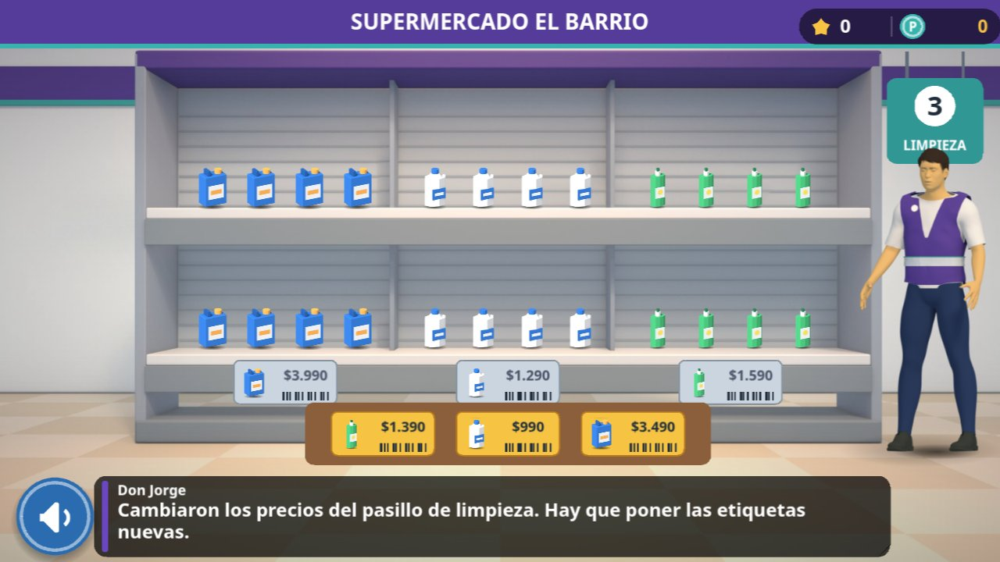 <br> 9. Cambiar etiquetas de precio |

## Uso

```bash
npm install
npm run dev        # http://localhost:5173
npm run build      # genera dist/ (sitio estático: GitHub Pages, itch.io, Netlify...)
```

En la pantalla de inicio, el botón **Etapas** permite al docente saltar a cualquier parte del juego.

## Publicar una actualización

Cada build lleva una versión automática: `versión de package.json + commit de git` (por ejemplo `0.1.0+7bc38a4`). Se ve abajo a la izquierda en la pantalla de inicio.

1. Hacer commit de los cambios (el hash del commit forma parte de la versión).
2. Opcional: `npm version patch` para subir el número (0.1.0 → 0.1.1).
3. `npm run build` **después** del commit, y subir la carpeta `dist/` completa (incluye `sw.js` y `workbox-*.js`). Si se compila antes del commit, la versión no cambia y los celulares no se enteran de la actualización.

`dist/` no está en git: se sube a mano al servidor (hoy, https://tecmedhub.org/mision_reponedor/).

**Vista previa al compartir el link** (WhatsApp, Facebook, Telegram): la imagen es `public/compartir.jpg` (1200×630) y los textos están en las etiquetas `og:` de `index.html`. WhatsApp solo muestra la imagen si tiene la dirección completa: poner la dirección pública del juego en `"sitio"` de `package.json` (por ejemplo `"https://mi-servidor.cl/reponedor/"`) antes del build, o usar `URL_SITIO=https://... npm run build`. WhatsApp guarda la vista previa un tiempo: si se cambia la imagen, conviene cambiarle el nombre.

No hace falta que nadie fuerce la recarga:

- Al abrir, el juego consulta `version.json` sin caché. Si hay una versión más nueva, instala el service worker nuevo y recarga solo (nunca a mitad de una partida).
- Imágenes y audios se piden con `?v=<versión>`, así que se descargan de nuevo cuando cambian.
- El código JS ya lleva un hash en el nombre, gracias a Vite.
- `public/_headers` le indica a Netlify y Cloudflare Pages que no guarden en caché `index.html`, `version.json` ni `sw.js` (otros servidores lo ignoran, y no pasa nada).

## Sin internet (PWA)

Después de abrir el juego una vez con internet, se puede jugar sin conexión, desde el navegador o instalado en la pantalla de inicio. Lo hace un service worker que genera `vite-plugin-pwa` (configuración en `vite.config.js`):

- **Precache** (~1,6 MB): `index.html`, el JS del juego, el manifest y los íconos.
- **Imágenes, voces y sonidos** (~20 MB, caché `assets-juego`): se guardan la primera vez que `Boot` los carga. Al terminar la carga, `prepararSinConexion()` (`src/lib/version.js`) guarda los que falten y borra los de versiones anteriores.
- `version.json` nunca se guarda: es lo que avisa que hay una versión nueva.
- En `npm run dev` no hay service worker. Para probarlo: `npm run build && npm run preview`, abrir el juego, cortar el servidor y recargar.

## Etapas (según el documento)

1. Crear personaje: nombre, hombre / mujer / no binario, piel, pelo, cara y ropa de calle.
2. Aviso de contratación en el celular.
3. Ropa de trabajo: elegir la vestimenta adecuada para el primer día. Se valida: pantalón largo y chaleco.
4. Conversación con el supervisor (habilidades sociales, con respuestas buenas y malas).
5. Lista de reposición: imagen del producto + cantidad, leída en voz alta. Luego el mapa del supermercado: ir a la bodega y, con el carro, elegir el pasillo correcto (1 Alimentos, 2 Bebidas, 3 Limpieza, 4 Higiene).
6. Tutorial guiado: identificar, buscar en la bodega, seleccionar y contar, trasladar, ubicar en la estantería, ordenar.
7. Práctica sin ayuda con una lista nueva, en el pasillo de higiene.
8. Órdenes del supervisor: encarga tres tareas en un orden al azar (derrame: botar la botella, limpiar y poner el letrero; basura; vencidos) y hay que elegirlas en ese orden; cada una tiene tiempo límite. Antes de cada tarea se camina por el mapa hasta su pasillo (`lugar` en `src/lib/flujo.js`). Después, orientar a una clienta y acompañarla caminando por el mapa hasta el pasillo del aceite.
9. Segundas órdenes (dos tareas): cambiar etiquetas de precio y colgar el cartel de oferta (pasillo de limpieza), y revisar faltantes en el pasillo de bebidas y verificar en la bodega si quedan (si no, avisar al jefe).
10. Fin del turno, con estrellas, puntos y errores por etapa.

El documento pide elegir la vestimenta al crear el personaje; aquí se elige después del aviso de contratación, que es el orden lógico (el requisito de elegir la ropa adecuada se mantiene).

## Celulares y tablets

El juego se juega en horizontal (en vertical aparece el aviso "Gira tu celular"). Al tocar COMENZAR pasa a pantalla completa donde el navegador lo permite (Android y iPad). En iPhone, Safari no deja usar pantalla completa desde una página: para ganar espacio, instalarlo con **Compartir → Agregar a inicio**; así se abre sin barras del navegador (en Android: menú → **Instalar app**). Instalado, también funciona sin internet (ver [Sin internet](#sin-internet-pwa)). El ícono y el modo de pantalla completa están en `public/manifest.webmanifest`.

En celulares (pantalla táctil con el lado corto < 500 px) se activa el **modo compacto** (`compacto()` en `src/lib/movil.js`): productos y zonas de toque más grandes (mínimo 44 px reales), lo que se arrastra va un poco arriba del dedo para que no lo tape, más margen al soltar, subtítulo y parlante más grandes. En iPhone con Safari, la portada muestra una vez cómo agregarlo a la pantalla de inicio. Para probarlo en PC: abrir con `?movil=1`. Plan completo en `docs/plan-movil.md`.

**Pantallas alargadas** (la mayoría de los celulares, ~19,5:9): el juego usa la escala `EXPAND` de Phaser y se ensancha para llenar la pantalla en vez de dejar franjas negras (los fondos cubren hasta 20:9). Todo se sigue dibujando en 1280×720 y un plugin (`Centrado`, en `src/lib/pantalla.js`) centra la cámara de cada escena; el marcador y el reloj se pegan a los bordes reales. Por eso los fondos y el mapa se renderizan a 20:9 (2000×900) con la franja central idéntica a la de 16:9 (`ANCHO_RENDER` en `tools/bl_util.py`), y lo que cubre toda la pantalla (capas oscuras, barras de título) va de `X_IZQ` a `X_IZQ + ANCHO_MAX` (`src/lib/estilo.js`). En tablets (4:3) quedan franjas arriba y abajo, como antes.

El campo del nombre es un `<input>` HTML que se ubica sobre el canvas (`campoTexto` en `src/lib/movil.js`) y va dentro del mismo contenedor que el canvas, para que se vea también en pantalla completa.

## Estrellas y puntos

Cada etapa con decisiones (marcadas con `id` en `src/lib/flujo.js`) da estrellas al terminar: 0 errores = 3, 1 o 2 errores = 2, más = 1 (nunca 0). Puntos: 100 / 70 / 40. El marcador está arriba a la derecha.

Tiempo límite: las etapas con `datos.tiempo` en `src/lib/flujo.js` (en segundos) muestran un reloj arriba a la izquierda. Si se acaba, la tarea sigue pero vale una estrella menos. Cada tiempo necesita su voz `tiempo_<segundos>` en el guion.

El progreso se guarda en el navegador (`localStorage`) por nombre de jugador: mejores estrellas por etapa, récord de puntos y partidas jugadas (`src/lib/perfil.js`).

## Desbloqueos

Con las estrellas guardadas (la mejor de cada etapa) se desbloquea, según `src/lib/premios.js`:

- Chalecos de reconocimiento: estrella (10★), experto (25★), plata (40★) y oro (55★, requiere jugar el turno 2). Se eligen en la fila "Chaleco" al crear el personaje; los bloqueados muestran las estrellas que faltan.
- Turno 2 (30★): pasillo de limpieza, con reloj en bodega y estantería, y el supervisor encarga 3 tareas al azar de las 5, con menos tiempo. Quien ya lo desbloqueó elige turno después de crear el personaje; también aparece un botón en la pantalla final.

- Días al azar (al terminar el turno 2): día 3, 4, 5… Mismo recorrido que el turno 2 (con reloj y 3 tareas al azar de las 5), pero cada día con otro pasillo, otros 3 productos (de 2 a 4 de cada uno), otra estantería (vacíos, un producto mal puesto, uno o dos chuecos) y otra fecha en la leche. Lo arma `src/lib/dias.js` en `niveles.dia`; el último día terminado se guarda en el perfil y la pantalla final ofrece el siguiente.

Al terminar un turno, una tarjeta "¡NUEVO!" muestra lo que se desbloqueó en esa partida.

## Personajes (MakeHuman + Blender)

Hay tres cuerpos (hombre, mujer y no binario) hechos con MakeHuman, con peinados, zapatos y expresiones. Blender los arma, saca la ropa (polera, pantalón, chaleco) del mismo cuerpo, agrega chalecos de reconocimiento y accesorios del supervisor (lentes, corbata y portapapeles), y renderiza **por capas en blanco** (piel, zapatos, pantalón, polera, chaleco, cara, pelo…) en 6 poses (quieto, habla, feliz, triste y dos de caminar). El juego colorea y combina las capas (`src/lib/personaje.js`). Cada capa se renderiza con lo que la tapa como *holdout*, así se pueden superponer en cualquier combinación.

```bash
npm run personaje            # los tres cuerpos → public/assets/personaje3d/<cuerpo>.png + .json
npm run personaje -- mujer   # solo algunos
```

Pasos (`tools/personaje.py`):

1. MakeHuman exporta cuerpos, peinados, zapatos y expresiones a `.cache/mh` (`tools/mh_exportar.py`, que abre MakeHuman con `tools/makehuman.sh` y su plugin `tools/makehuman/9_mision_reponedor.py`). Solo la primera vez, o si se borra esa carpeta o se cambia un modelo. Para afinar un cuerpo a mano: guardar `tools/makehuman/modelos/<cuerpo>.mhm` desde MakeHuman.
2. Blender arma, viste y renderiza cada capa en cada pose (`tools/gen_personaje_mh.py`).
3. Se recortan las imágenes y se empaqueta un atlas por cuerpo.

Requiere MakeHuman 1.3 en `/opt/makehuman`, Blender y uv.

Todos los fondos y el personaje usan la misma escala: una persona de 1,72 m mide ~380 px con los pies en y = 600 (`ESCALA` y `enPiso()` en `personaje.js`). El personaje respira, parpadea, gesticula y mueve la boca con su voz (con un globo de diálogo), camina en el mapa y el traslado, y el del jugador celebra los aciertos y se pone triste con los errores (cada `sfx()` emite `reaccion`).

## Editar textos y voces

- Guion: `src/data/voces.json`. Las versiones `id_f` (mujer) e `id_n` (no binario, lenguaje neutro) reemplazan a `id` según el personaje.
- Productos (con su pasillo): `src/data/productos.json`. Pasillos: `src/data/pasillos.json`. Listas, pasillo y estanterías de cada nivel: `src/data/niveles.json`.
- Después de editar, regenerar los audios (requiere [uv](https://docs.astral.sh/uv/)):

```bash
npm run voces
```

Solo se regeneran las líneas que cambiaron.

## Mapa (Blender)

El mapa del supermercado es un render isométrico modelado en `tools/gen_mapa.py` (bodega, cuatro pasillos con su color, cajas, entrada y clientes), siguiendo la imagen de referencia del documento. El script también calcula dónde queda cada zona en pantalla y lo guarda en `src/data/mapa.json`. Los muebles que pueden tapar al personaje (góndolas, cajas, muros de la bodega, pallets, personas) se recortan del fondo como piezas (`public/assets/mapa/piezas.png`, con `tools/mapa.py`) y el juego las dibuja delante o detrás del personaje según dónde pisa:

```bash
npm run mapa
```

## Bodega y estanterías (Blender)

Los fondos de la bodega (rack azul con cajas y carro), la estantería de la sala (góndola con riel de etiquetas y carro) y la góndola de 3 secciones de las tareas de Precios y Faltantes se renderizan en `tools/gen_escenarios.py`. La cámara mira de frente al mueble con 1 m = 200 px, así las cajas y repisas del render calzan con las posiciones que usan las escenas; la posición del carro se guarda en `src/data/escenarios.json`:

```bash
npm run escenarios
```

Las funciones comunes de Blender están en `tools/bl_util.py`.

## Luz y sombras

- **Renders** (`bl_util.escena()`): sol cálido con relleno frío, lámparas cálidas, oclusión y rebote de luz (raytracing de EEVEE) y una sola dirección de sol (`LUZ_SOL`) para los fondos de frente y el personaje. Los productos usan la misma escena con sol neutro (`calida=False`), para combinar con los de Kenney. Curva de tonos Standard: AgX apagaba los colores de marca.
- **Modelos**: las cajas llevan bisel y los cilindros son redondos con sombreado suave (`caja()`, `cil()`); la gente de fondo es de cápsulas (`capsula()`).
- **En el juego** (`src/lib/sombras.js`, hecho al cargar con degradados en canvas): sombra suave bajo personajes y carros, sombra de contacto horneada en cada producto, productos "levantados" al arrastrarlos, sombras difusas de paneles y botones, y una viñeta suave sobre los fondos. Nada es un efecto en tiempo real, para no bajar los fps en celulares.

## Probar cambios de luz (Blender)

Para no regenerar todo en cada ajuste de luz o materiales, hay un banco de pruebas que renderiza una vista chica de la sala, la bodega, el mapa, dos productos, el personaje y una muestra de los colores de marca, sin tocar los assets:

```bash
npm run muestras -- antes          # .cache/muestras/antes/ (~4 min; el mapa es lo más lento)
# ...cambiar la luz...
npm run muestras -- despues sala   # solo algunas: sala, bodega, mapa, producto, personaje, marca
npm run comparar -- antes despues  # lámina lado a lado: .cache/muestras/antes_vs_despues.png
```

## Productos nuevos (Blender)

Los productos de Kenney son de comida. Los de limpieza, higiene y el agua se modelan con formas simples en `tools/gen_productos.py` y se renderizan con Blender en el mismo estilo:

```bash
npm run productos            # todos
npm run productos -- cloro   # solo algunos
```

Requiere Blender y uv. Deja PNG de 128 px en `public/assets/productos/`.

## Identidad visual

El supermercado "El Barrio" es ficticio y usa **violeta + turquesa** para no parecerse a cadenas reales (Jumbo, Líder, Unimarc, Tottus, Santa Isabel).
